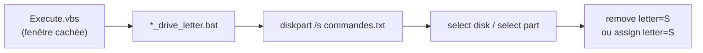

<div align="center">

# 🫥 Hide disk partition (Windows)

**Fais disparaître une partition de l'Explorateur, et fais-la revenir, d'un double-clic silencieux.**


</div>

---

## ✨ Ce que fait le projet

Une partition sans **lettre de lecteur** n'apparaît plus dans l'Explorateur, mais ses données restent intactes. Deux outils :

| Dossier | Effet |
|---|---|
| `remove_letter_disk/` | retire la lettre `S:` → la partition est masquée |
| `assign_letter_disk/` | réattribue la lettre `S:` → la partition réapparaît |

Le fichier `Execute.vbs` lance le script **sans fenêtre de console**.

> ℹ️ Ce n'est **pas une protection** : n'importe quel administrateur voit la partition dans la Gestion des disques. Pour protéger des données, utilise BitLocker.

---

## 🚀 Utilisation

1. Ouvre la **Gestion des disques** (`diskmgmt.msc`) et repère le numéro du disque et de la partition.
2. Adapte les deux fichiers `diskpart_*_commands.txt` :
   ```
   select disk 2
   select part 2
   remove letter=S
   ```
3. Double-clique sur `Execute.vbs` dans le dossier voulu, et accepte l'élévation administrateur.

> ⚠️ Vérifie bien les numéros : diskpart agit sur le disque sélectionné sans demander de confirmation.

---

## ⚙️ Comment ça marche



---

## 🗂️ Organisation des fichiers

```
Hide-disk-part-win10/
├── remove_letter_disk/
│   ├── Execute.vbs                    lancement silencieux
│   ├── remove_drive_letter.bat        appelle diskpart
│   └── diskpart_remove_commands.txt   disque, partition et lettre à retirer
└── assign_letter_disk/
    ├── Execute.vbs
    ├── assign_drive_letter.bat
    └── diskpart_assign_commands.txt   disque, partition et lettre à attribuer
```

---

## 💻 Compatibilité

| | |
|---|---|
| **Système** | Windows 10 et 11 |
| **Droits** | administrateur (diskpart) |

---

<div align="center"><sub>Batch · VBScript · diskpart</sub></div>
